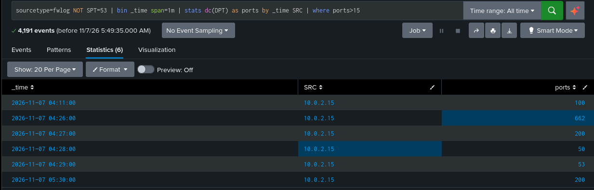
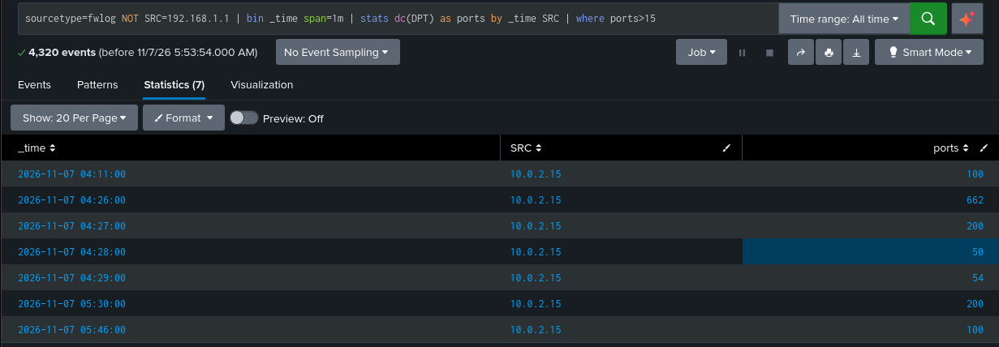
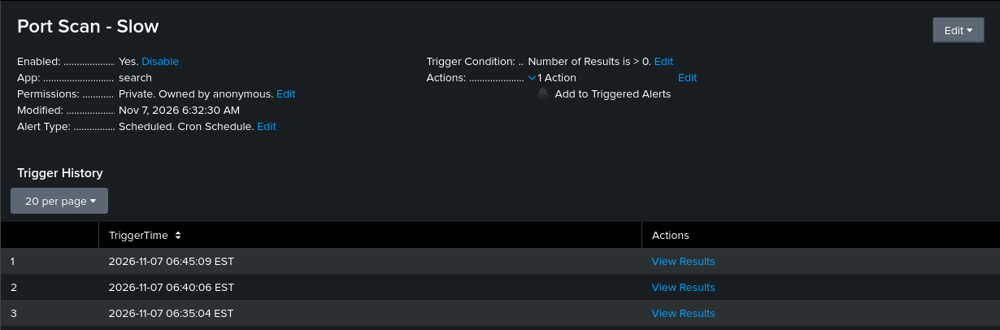

# Port Scan Detection Engineering with Splunk

A hands-on home lab project simulating multiple Nmap reconnaissance
techniques and building tuned Splunk detection rules that identify port
scans while minimizing false positives.

## Objective

Run several scan types (SYN, NULL, FIN, Xmas, UDP, slow, and
source-port-spoofed) from an attacker VM against a vulnerable target, then
build Splunk detection rules and scheduled alerts that catch them. The
focus is on **tuning**: finding a real false positive, fixing it, then
finding and closing the evasion gap the first fix created.

MITRE ATT&CK: T1046 - Network Service Discovery

## Lab Architecture

| Component | Role | IP |
|---|---|---|
| Kali Linux | Attacker + SIEM (Splunk) | 10.0.2.15 |
| Metasploitable2 | Scan target | 10.0.2.7 |
| DNS server | Normal traffic (the false positive source) | 192.168.1.1 |

Both VMs run in VirtualBox on a NAT Network, isolated from the host's
production network.

**Data flow:**
```
Nmap (scans) → Metasploitable2 iptables LOG → /var/log/kern.log
→ scp pull (cron, every 1 min) → Kali local file
→ Splunk file monitor input → SPL detection rules → Scheduled Alerts
```

## Attack Simulation

Seven scan types were run from Kali against the target:

| Scan | Command |
|---|---|
| SYN | `sudo nmap -sS -p 1-1000 10.0.2.7` |
| NULL | `sudo nmap -sN -p 1-200 10.0.2.7` |
| Xmas | `sudo nmap -sX -p 1-200 10.0.2.7` |
| UDP | `sudo nmap -sU -p 1-100 10.0.2.7` |
| FIN | `sudo nmap -sF -p 1-200 10.0.2.7` |
| Slow SYN | `sudo nmap -sS -T1 -p 1-20 10.0.2.7` |
| Spoofed source port | `sudo nmap -sS --source-port 53 -p 1-100 10.0.2.7` |

- `-T1` sends one probe roughly every 15 seconds, spreading the scan
  across many minutes to test evasion of short time windows
- `--source-port 53` fakes DNS-style source ports to test whether a
  tuning rule can be bypassed

## Log Collection

Port scans never appear in `auth.log`, so network-level logging was needed
on the target. iptables LOG rules record each scan type:

```bash
iptables -I INPUT -p tcp --syn -j LOG --log-prefix "FWLOG TCP_SYN: "
iptables -I INPUT -p tcp --tcp-flags ALL NONE -j LOG --log-prefix "FWLOG TCP_NULL: "
iptables -I INPUT -p tcp --tcp-flags ALL FIN -j LOG --log-prefix "FWLOG TCP_FIN: "
iptables -I INPUT -p tcp --tcp-flags ALL FIN,PSH,URG -j LOG --log-prefix "FWLOG TCP_XMAS: "
iptables -I INPUT -p udp -j LOG --log-prefix "FWLOG UDP: "
iptables -I INPUT -p icmp -j LOG --log-prefix "FWLOG ICMP: "
```

Rate limiting was intentionally left off so scan evidence is not dropped.

The log is pulled to Kali with the same scp and cron method used in the
SSH brute force project:

```bash
#!/bin/bash
sshpass -p 'msfadmin' scp -o StrictHostKeyChecking=no \
  msfadmin@10.0.2.7:/var/log/kern.log /tmp/kern.log
```

```
# crontab -e
* * * * * /home/kali/pull_kern_log.sh
```

Splunk monitors `/tmp/kern.log` via a **Files & Directories** input
(sourcetype: `fwlog`). Splunk auto-extracts `SRC`, `DST`, `DPT`, and `SPT`
from the log lines.

## Detection Logic (SPL)

**Rule 1: Fast scan (1-minute window)**

```spl
sourcetype=fwlog NOT SRC=192.168.1.1
| bin _time span=1m
| stats dc(DPT) as ports by _time SRC
| where ports > 15
```

**Rule 2: Slow scan (15-minute window, SYN packets only)**

```spl
sourcetype=fwlog TCP_SYN
| bin _time span=15m
| stats dc(DPT) as ports by _time SRC
| where ports > 10
```

**Logic:**
1. Filter to firewall log events (excluding the allowlisted DNS server in
   Rule 1)
2. Bucket events into time windows
3. Count distinct destination ports touched per source IP per window
4. Flag any source exceeding the port threshold as scan behavior

A scan stands out because one source touches many different ports in a
short time. Normal traffic usually touches one or two.

## False Positive Tuning

| Version | Change | Outcome |
|---|---|---|
| v0 | Threshold lowered to 3 to expose noise | `192.168.1.1` (DNS replies, source port 53) appeared at 04:26 and 05:14 with 4 ports each |
| v1 | Added `NOT SPT=53` | False positive removed, all scans still caught |
| v1 test | Ran Nmap with `--source-port 53` | **Blind spot:** the spoofed scan did not appear |
| v2 | Replaced `NOT SPT=53` with `NOT SRC=192.168.1.1` | Spoofed scan caught (100 ports at 05:46) |

**Before (v1) and after (v2), same time range:**








The DNS server touched 77 distinct destination ports overall, because each
reply landed on a different ephemeral port. A threshold of 15 per minute
already filtered it, which shows why the threshold value matters.

**Key lesson:** excluding by a field the attacker controls (source port)
can be evaded. Allowlisting a trusted address is safer, though it still
carries risk if that address is spoofed or compromised.

## Results

| Scan | Fast rule | Slow rule | Notes |
|---|---|---|---|
| SYN, NULL, Xmas, UDP | Detected | n/a | Four flagged windows (04:26 to 04:29) with 50 to 662 distinct ports |
| FIN | Detected | n/a | 200 ports at 05:30 |
| Slow SYN (-T1) | **Missed** (2 to 5 ports/min) | Detected | 21 distinct ports in one 15-minute window |
| Spoofed source port 53 | Missed by v1, detected by v2 | n/a | 100 ports at 05:46 |


## Alerts

| Alert | Schedule | Search window | Trigger | Severity |
|---|---|---|---|---|
| Port Scan - Fast | `*/5 * * * *` | Last 15 minutes | Results > 0 | High |
| Port Scan - Slow | `*/5 * * * *` | Last 60 minutes | Results > 0 | Medium |





Port Scan - Fast fired at 06:05, 06:10, and 06:15 EST after a fresh scan.
Port Scan - Slow fired at 06:35, 06:40, and 06:45 EST. One scan triggers
repeatedly while it stays inside an alert's search window.

The Slow alert would also fire on a fast scan, since a fast scan touches
many SYN ports too. Its distinct value is catching the slow scan the Fast
rule misses (21 ports in one 15-minute window, versus 2 to 5 per minute).

## Limitations

- Fixed 15-minute bins can split a slow scan across two bins, so each half
  may fall under the threshold. A sliding window would fix this.
- Logged counts were lower than packets sent (the 1-1000 SYN scan appeared
  as 662 distinct ports), likely from kernel log rate limiting.
- Only one scanner and one target were tested.
- The allowlist assumes `192.168.1.1` cannot be spoofed.
- Ping sweeps and version scans (`-sV`) were not tested.

## Key Takeaways

- Built a detection pipeline from scan simulation through logging,
  ingestion, detection, and automated alerting
- Found a real false positive, fixed it, then proved the fix could be
  evaded and replaced it with a stronger allowlist
- Showed why one time window is not enough by pairing a fast rule with a
  slow-scan rule
- Practiced SPL distinct-count aggregation, time-bucketed analysis, and
  threshold-based alerting

## Tools Used

- Kali Linux (attacker + Splunk host)
- Metasploitable2 (target)
- Nmap
- Splunk Enterprise (trial)
- iptables
- VirtualBox

## Future Improvements

- Sliding-window slow-scan detection using `streamstats`
- Detect one source probing many hosts (horizontal sweeps)
- Add Zeek or Suricata for richer network telemetry
- Test ping sweeps and `-sV` version detection
